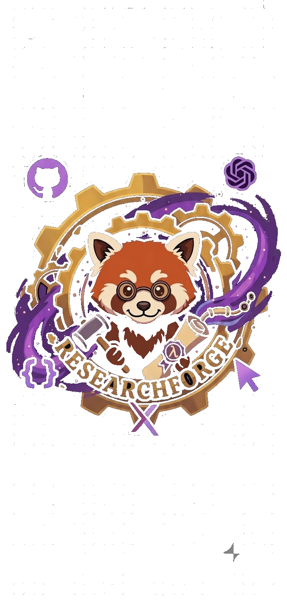
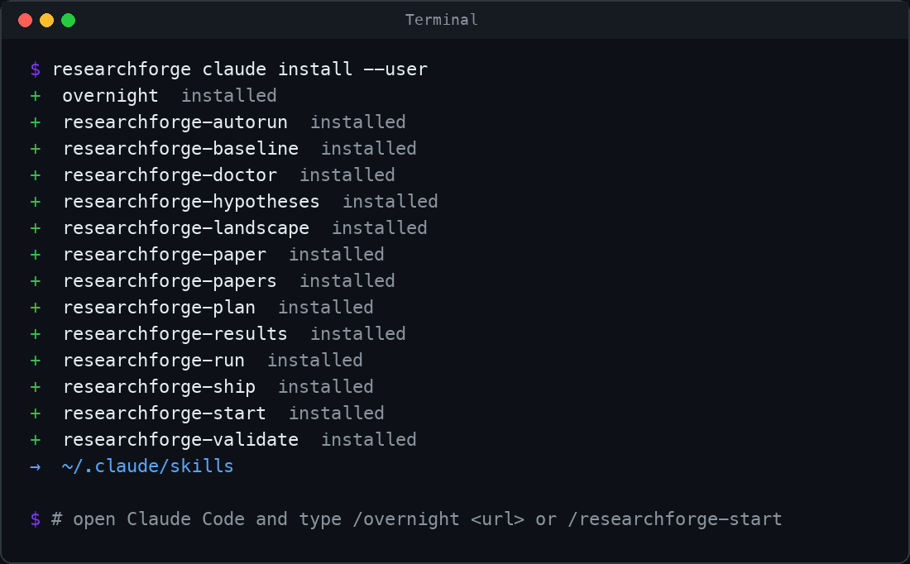
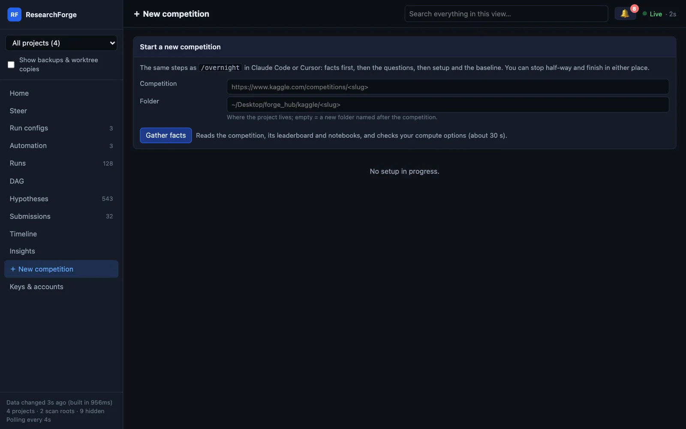
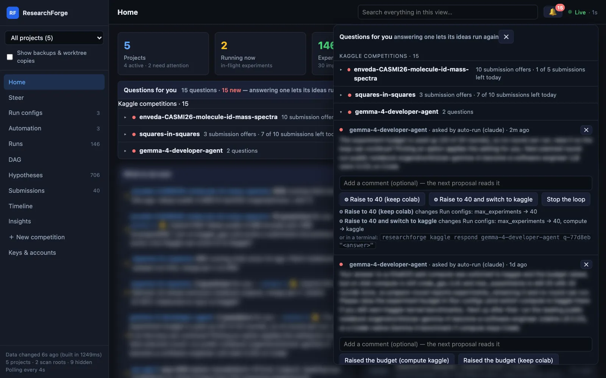
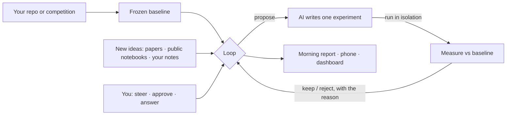
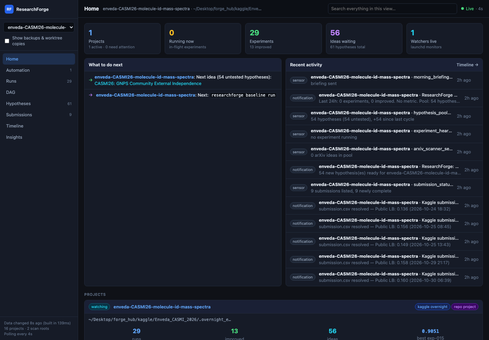
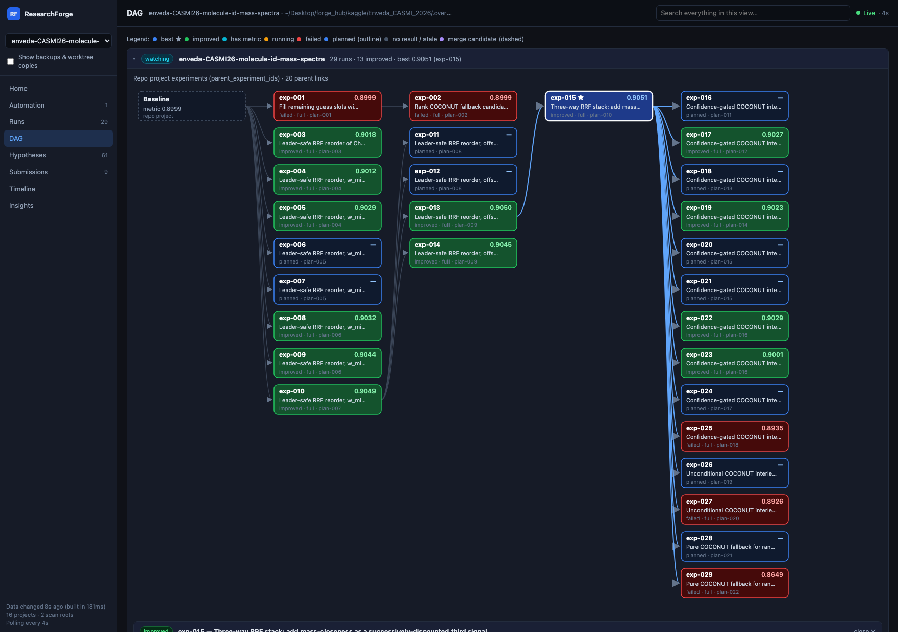
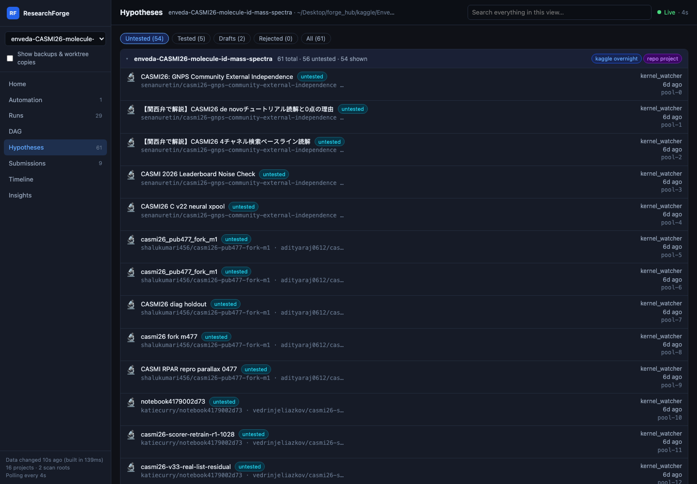

<div align="center">



<h1>ResearchForge</h1>

<p><strong>Run experiments on your code overnight. Keep only what beats the baseline.</strong></p>

<p>Give it a Kaggle competition or your repository before bed. On Kaggle it keeps your score current: every hour it finds the public notebooks scoring above you and turns them into rounds, then auto-run keeps experimenting on top of them. On your repository, an AI proposes experiments and ResearchForge measures each one against a frozen baseline, keeping only real wins. Nothing is submitted or shipped without your yes. Inspired by https://github.com/karpathy/autoresearch . </p>

<p>
  <a href="https://pypi.org/project/researchforge/"></a>
  <a href="https://pypi.org/project/researchforge/"></a>
  <a href="https://github.com/forger-labs-hq/researchforge/blob/main/LICENSE"></a>
  <a href="https://github.com/forger-labs-hq/researchforge/stargazers"></a>
</p>

<h3><a href="#try-it-tonight">🚀 Try it tonight</a> &nbsp;·&nbsp; <a href="#demo">▶ Watch the 60-second demo</a> &nbsp;·&nbsp; <a href="https://github.com/forger-labs-hq/researchforge">⭐ Star on GitHub</a></h3>

<p><a href="#every-way-to-run-it">Every way to run it</a> · <a href="#walkthroughs">Walkthroughs</a> · <a href="#what-you-get">Features</a> · <a href="#the-dashboard">Dashboard</a> · <a href="#real-results">Results</a> · <a href="#faq">FAQ</a> · <a href="https://www.researchforgehq.com/docs">Docs</a></p>

</div>

<a id="demo"></a>

https://github.com/user-attachments/assets/4ac96b88-c16d-4332-a660-534ccc3bdec1

# Try it tonight

### 1. Install (one minute)

```bash
pip install researchforge
researchforge claude install --user     # using Cursor? researchforge cursor install --user
```



### 2. Start, in Claude Code (in Cursor, type `@` instead of `/`)

**First, open Claude Code or Cursor in the folder you want to work in.** For a repository, that's the repository itself. For a Kaggle competition, use a new or empty folder. ResearchForge keeps everything for the project in that folder (`.researchforge/` for a repository, `.overnight_<competition>/` for Kaggle), and every command below runs there.

| To improve… | Type |
|---|---|
| a Kaggle score | `/overnight https://www.kaggle.com/competitions/titanic` (or any competition you've joined). It keeps your score up to date with the best public notebooks, then improves on them. Setup offers auto-run too. |
| your repository | `/researchforge-start` in a chat opened in your repo, then `/researchforge-autorun`: Claude runs the loop in the chat, round after round, with no API key |
| either, with nothing open | Auto-run: `researchforge kaggle auto-run <name> --on` for a competition, `researchforge auto-run settings --on --driver claude` for a repository ([how it works](#run-it-with-nothing-open)) |

> 📊 **Watch it live at [http://localhost:7842](http://localhost:7842).** `/overnight` opens the dashboard for you; for a repository, run `researchforge dashboard`.



<sub>No editor? <b>＋ New competition</b> in the dashboard runs the same setup as <code>/overnight</code>, as a form.</sub>

### 3. Go to sleep

It asks a few questions, then runs round after round. Nothing is submitted or shipped until you say yes. When it needs a decision, the question reaches you two ways:

- **On your phone:** install the free [ntfy](https://ntfy.sh) app and subscribe to your topic. Set it with `researchforge notify setup --topic <a-name-nobody-can-guess>`, or in the dashboard under **Run configs → Notifications**, which also has a **Send test alert** button.
- **In the dashboard:** the 🔔 at the top and the **Questions for you** list on Home show every open question, grouped by competition with how many submissions Kaggle still allows today. Answer right there: **Approve & submit** or **Don't submit**, add a comment the next round will follow, or dismiss it with ✕. An answer marked ⚙ also changes the setting it names (say, compute → Kaggle GPU) in Run configs when you pick it.



No Claude Code or Cursor? [Use an API key or a local model from the terminal](#every-way-to-run-it).

## What happens overnight

| When | What happens |
|---|---|
| **Tonight** | You give it a competition URL or open your repo, and answer a few questions: where to run, for how long, where to send alerts. |
| **Every hour (Kaggle)** | It checks the competition's public notebooks, re-runs included, and ranks them by the score they claim. The ones ahead of your best are adopted or merged into rounds on your compute, so your score keeps pace with the best public work. |
| **Every round** | The AI proposes one change → it runs on your chosen GPU, or in an isolated copy of your repo → it's scored against the baseline → kept, or rejected with the reason. |
| **When it needs you** | Your phone gets *"Submit R7 to Kaggle?"* or *"plan-003 waits for your approval"*. Answer from the dashboard. |
| **Morning** | A briefing: what improved, what failed and why. One click to submit to Kaggle; one command to ship a branch. |

# Every way to run it

Pick **what** you want to improve and **where** you'll drive it from. Each cell is the command that starts it. Run it from the folder the project lives in: your repository, or a folder for the competition.

| | **Claude Code** | **Cursor** | **Terminal only** |
|---|---|---|---|
| **A Kaggle competition** | `/overnight <competition-url>` | `@overnight <competition-url>` | `researchforge kaggle overnight <competition-url>`<br>then `researchforge kaggle run <slug>` |
| **Your repository** | `/researchforge-start`, then `/researchforge-autorun` | `@researchforge-start`, then `@researchforge-autorun` | [ten commands, below](#improve-a-repository) |
| **A research idea** | `/researchforge-start` | `@researchforge-start` | [four commands, below](#explore-a-research-idea) |
| **One-time setup** | `researchforge claude install --user` | `researchforge cursor install --user` | an API key: `export ANTHROPIC_API_KEY=…` (or `GEMINI_API_KEY`, `OPENAI_API_KEY`), or a local model: `export RESEARCHFORGE_LLM=ollama/qwen3:14b` |
| **Who proposes experiments** | Claude, in your chat | Cursor's agent, in your chat | the API model, or your local model |
| **API key needed** | No, your Claude plan | No, your Cursor plan | Yes, or none with [Ollama](https://ollama.com) |
| **Must stay open** | the chat | the chat | the terminal |

The three columns are independent: install for Claude Code and Cursor and set a key, and use whichever fits the moment. To keep going with **nothing** open, turn on [auto-run](#run-it-with-nothing-open).

**Lost at any point?** `researchforge status` prints the exact next command for the project you're in.

## Setup in two minutes

1. `pip install researchforge` (Python 3.12+ and git). `researchforge doctor` checks your machine.
2. Set up one or more ways to drive it, from the last row of the table above. `researchforge all install --user` sets up Claude Code and Cursor together.
3. For Kaggle: join the competition on kaggle.com and add your [Kaggle API token](https://www.kaggle.com/settings) to `~/.kaggle/`, or paste it into the dashboard's **Keys & accounts** page.
4. Optional: phone alerts with [ntfy](https://ntfy.sh): `researchforge notify setup --topic <a-name-nobody-can-guess>`.
5. Optional: the live dashboard: `researchforge dashboard` (http://localhost:7842).

# Walkthroughs

## Keep up with the Kaggle leaderboard, then improve on it

**You need:** a Kaggle account that has joined the competition, and its API token.

### In Claude Code or Cursor
1. Type `/overnight https://www.kaggle.com/competitions/<name>` (`@overnight` in Cursor).
2. It reads the competition (metric, data size, deadline, top public notebooks) and your machine, then asks a few questions: where to run (local GPU, Kaggle GPU, Colab, your SSH server or a cloud GPU, each with what it found and a recommendation), how long, phone alerts, and whether to keep going on its own.
3. **It keeps your score current.** Every hour it checks the competition's public notebooks and ranks them by the score they claim. The ones ahead of your best become rounds first, adopted as they are or merged with your best, so you keep pace with the leaders' public work.
4. **Then it improves on that.** It runs its own rounds on top: propose an experiment → run it on the compute you chose → score it against your best → keep or reject. Your directions on **Steer**, arXiv papers and the loop's own results feed the ideas. Every improved round that Kaggle could take raises a **Submit?** question.
5. Keep the chat open, or say yes to auto-run in step 2 so rounds continue with the chat closed.

### In a terminal (with an API key or a local model)

```bash
researchforge kaggle overnight https://www.kaggle.com/competitions/<name> --gpu kaggle --time-hours 8
researchforge kaggle run <name>          # the loop
researchforge kaggle finish <name>       # the morning report
```

### In the morning

A briefing on your phone, and the dashboard shows every round. To send a round to Kaggle, click **Approve & submit** on its question. It checks Kaggle's daily limit first and never sends the same round twice.

No editor at all? Open the dashboard, click **＋ New competition**, paste the URL and answer the same questions as a form.

## Improve a repository

**You need:** a git repository with its work committed, and a command that measures what you care about: a benchmark, an eval script or a test that prints a number (accuracy, F1, latency, …).

### In Claude Code or Cursor, opened in your repository
1. Type `/researchforge-start` (`@researchforge-start` in Cursor), choose **Improve a repository**, and give one sentence naming the metric: *"Raise F1 without slowing inference."*
2. It scans the repo, searches arXiv for related work and proposes testable hypotheses.
3. It drafts the **contract**, `researchforge.yaml`: the metric, hard limits (like latency), which files experiments may change and which are protected. **You read it and approve it** by typing.
4. It measures the **baseline** once and freezes it. Every experiment is compared to this number.
5. Type `/researchforge-autorun`. Each round it plans experiments, you approve the first batch, and they run in separate git worktrees (your checkout is never touched), get measured, and feed the next round's hypotheses.

### In a terminal (with an API key or a local model), from your repository

```bash
researchforge project create --mode improve_repository --objective "Raise F1 without slowing inference"
researchforge repo scan .
researchforge research search            # related papers from arXiv
researchforge research synthesize        # research directions and testable hypotheses
researchforge report build
researchforge contract generate          # drafts researchforge.yaml: read it and edit it
researchforge contract approve           # you type the approval
researchforge baseline run               # measured once, then frozen
researchforge autorun --target 0.85 --max-hours 8
researchforge results show               # in the morning: ranking, trade-offs, rejections
```

### In the morning
- `researchforge results show` ranks what ran, with each rejection's reason.
- `researchforge validate <run-id>` re-runs the winner to confirm it.
- `researchforge ship branch` rebuilds it as a clean local branch.
- `researchforge ship pr` pushes it as a draft PR, only if you run it.

## Explore a research idea

### In Claude Code or Cursor

Type `/researchforge-start` and choose **Explore a research idea**. It searches arXiv, groups the papers into directions, proposes ranked, testable hypotheses and writes a cited report. `/researchforge-paper` adds BibTeX and an evidence matrix.

### In a terminal

```bash
researchforge project create --mode explore_research_idea --objective "<your question>"
researchforge research search
researchforge research synthesize
researchforge report build
```

Attach a repository later and the same project can run experiments on those hypotheses.

## Run it with nothing open

Auto-run starts rounds on its own from a background service (launchd on macOS, a systemd timer on Linux, Task Scheduler on Windows). It drives headless Claude Code, the Cursor agent or your API key, whichever you pick. Save that tool's token or key on the dashboard's **Keys & accounts** page.

```bash
# a Kaggle competition
researchforge kaggle auto-run <name> --on
researchforge kaggle scheduler-install <name>

# a repository
researchforge auto-run settings --on --driver claude     # or cursor, or byok (your API key)
researchforge auto-run service
```

It stays inside daily limits and a time limit per launch, and waits out the driver's usage limit instead of failing. Submissions still wait for **Approve & submit**. Repository plans wait for **Approve plan**, unless you type a standing approval with `researchforge auto-run approval standing`. The machine running it has to stay on.

# How it works



Winners become the starting point for the next round, independent wins are merged, and every failure is kept with its reason so it isn't tried again.

# What you get

| | |
|---|---|
| **[Your choice of AI](https://www.researchforgehq.com/docs/drivers)** | Claude Code or Cursor on your plan (no API key), an Anthropic, Gemini or OpenAI key, or a local Ollama model. |
| **[Compute & GPUs](https://www.researchforgehq.com/docs/compute)** | This machine (CUDA, Apple MPS or CPU), Kaggle GPU with a daily cap on runs, Google Colab through its CLI (Free to Pro+, T4 to H100), your SSH server, or RunPod and Lambda. Setup checks each option and recommends one, with the reason. Competition data stays on the compute you pick. |
| **[You approve what matters](https://www.researchforgehq.com/docs/submissions)** | **Approve & submit** sends a Kaggle round only after your click, checks Kaggle's daily limit first and never sends a round twice. Repository plans wait for **Approve plan**, where you type `approve`. Shipping a winner is `researchforge ship`. |
| **Steer it like a chat** | "Stop tuning LightGBM, try a transformer": a direction for the next round, the next few, or every round, with the proposer's reply under it. **Up next** is one numbered queue: your directions first (newest on top), then ideas you pin, then the engine's own ranking; move any of them with ↑/↓ or drag. A **Next round** banner says what #1 is and when it starts. The next round must follow #1 or say why it can't. Rounds that followed you are marked 🧭 on Runs, DAG and Hypotheses; each one that wrote a submission file gets a Submit? offer, even if it did not beat the best, and those offers sit at the top of 🔔. Pause, resume, add an idea or rebuild the idea pool from the same page. |
| **Failed submissions fix themselves** | When Kaggle fails a submission (a timeout on the hidden test set, out of memory, a wrong file), a 🔧 fix round goes to the top of Up next with Kaggle's reason and the run log. It must print `FIX_CHECK: passed <evidence>` before it is offered for submission, first in 🔔. Two tries, then it asks you. |
| **[Questions & notifications](https://www.researchforgehq.com/docs/notifications)** | 🔔 has two tabs: **Needs you** (what the loop waits on) and **Submit?** (offers, nothing sent without your yes). When the loop needs you, it asks on your phone (ntfy), in the dashboard's 🔔 and on Home. Questions are grouped by competition, and submission offers show how many submissions are left today. An answer that names a settings change (⚙) applies it to Run configs when you pick it, never on its own. Only the ideas a question names wait. Every answer takes a comment that the next proposal follows. A morning briefing sums up the night. |
| **Runs with nothing open** | Auto-run for competitions and repositories: launches run back to back (the next within 10 minutes), up to 20 rounds a day by default, with a time limit per launch and a wait for the driver's usage limit to reset. Questions waiting for you never stop it. |
| **Background checks** | Public notebooks every hour (ranked by the score their author claims), new arXiv papers, your submissions being scored, stuck rounds, and your own shell checks. |
| **Keeps your Kaggle score current** | Public notebooks that claim a better score than yours are tried first: adopted or merged as measured rounds on your compute, then offered to you as submissions. Auto-run builds on them with your directions, arXiv papers and its own results. Nothing from a notebook runs on your machine, and nothing is submitted without **Approve & submit**. |
| **Knows the metric** | Reads the leaderboard to tell whether lower or higher is better, and says where that came from. |
| **One place for keys** | Every key (Kaggle, AI providers, Claude Code and Cursor tokens, Colab, cloud GPUs) set and tested on one page, stored in a file only you can read, never shown again and never typed into a chat. |

# The dashboard

```bash
researchforge dashboard        # http://localhost:7842 — runs on your machine, nothing leaves it
```

Every competition and repository project on the machine, updating live.



| View | What it's for |
|---|---|
| **Home** | Every project at a glance, what to do next, and the questions waiting for you |
| **Steer** | Up next: your directions and pinned ideas in your order, the engine's next ideas, pause and resume |
| **Run configs** | Every setting (compute, AI, auto-run, budgets, metric direction, notifications), editable, with a change log |
| **Automation** | Background checks, the background service, and auto-run for competitions and repositories |
| **Runs** | Each round with its local score and its Kaggle LB score once submitted, the AI that proposed it, and its log; submit any finished round to Kaggle, archive and restore |
| **DAG** | The experiment graph: which round built on which, merges, the best one; submit a round from its details |
| **Hypotheses** | The idea pool, where each idea came from, what tested it, what was rejected and why |
| **Submissions** | What went to Kaggle, its scores, and how many submissions are left today |
| **Timeline** | Deadline countdown, runs, checks and notifications in order |
| **Insights** | Improvement rate, metric progression per project, and AI token use: input and output tokens per model (cached input shown), with the cost Claude Code reports for auto-run launches and sensor calls |
| **＋ New competition** | Paste a Kaggle URL, answer the setup questions as a form, start |
| **Keys & accounts** | Set and test every key and sign-in |

<table>
<tr>
<td width="50%"><br><sub><b>DAG</b> — real parent links; click a node for its patch and reasoning.</sub></td>
<td width="50%"><br><sub><b>Hypotheses</b> — where each idea came from and which run tested it.</sub></td>
</tr>
</table>

# Real results

**Kaggle:** our own submissions, with public leaderboard scores from the Kaggle API on **2026-11-15**.

| Competition | Status | Public LB (first → best) | Notes |
|---|---|---|---|
| [ARC Prize 2026 — ARC-AGI-3](https://www.kaggle.com/competitions/arc-prize-2026-arc-agi-3) | Submissions closed 2 Nov; results 4 Dec | 0.08 → **32.51** | No medal claim before the final results |
| [Gemma 4 developer agent](https://www.kaggle.com/competitions/gemma-4-developer-agent) | Live run, open until 2 Dec | 0.05 → **0.17** | The public LB is noisy for this task; treat single scores with care |
| [Enveda CASMI 2026](https://www.kaggle.com/competitions/enveda-CASMI26-molecule-id-mass-spectra) | Live run, open until 14 Dec | 0.136 → **0.479** | Rank 3,856 (5 Nov) → **1,421 of 5,305** (15 Nov). Our own rounds reached 0.213; adopting a top public notebook's pipeline as a round took it to 0.479 |

**Keeping up, then pulling ahead:** on Squares in Squares, rounds R40–R45 merged the notebooks the hourly check found, moving the local score from 22.1756 to 22.1580 (lower is better). So far the biggest gains come from keeping up with public work; our own ideas add smaller steps on top, like Enveda's 0.166 → 0.213.

**A repository:** [YOLOv5 on COCO128](https://github.com/forger-labs-hq/researchforge/blob/main/docs/demo.md). The most accurate variant reached mAP@0.5 **0.7683** against the 0.7395 baseline and was **rejected**, because it took 291 ms per image against a 200 ms budget. A tool that only looked at the main metric would have shipped it.

# FAQ

**Do I need an API key?** No, if you use Claude Code or Cursor: your plan is the AI. A key (or a local Ollama model) is for the terminal-only path and for auto-run's `byok` option.

**Does my computer have to stay on?** Yes, the machine running the loop does. With Kaggle GPU, Colab or a cloud GPU the experiments run there, but the loop that sends them runs on your machine. Use an always-on machine if you want your laptop free.

**Will it submit to Kaggle or push code without me?** No. Kaggle submissions need **Approve & submit**, and code leaves your machine only when you run `researchforge ship pr`. Unattended runs can't submit, approve a plan, delete a round or ship.

**Can it break my repository?** Experiments run in separate git worktrees, so your checkout is never touched. `ship branch` creates a new local branch.

**What does it cost?** Your existing Claude or Cursor plan, or your API usage. Ollama, Kaggle GPU and Colab Free cost nothing. Paid Colab plans and cloud GPUs bill you directly.

**Where are my keys stored?** Kaggle's in `~/.kaggle/`, the rest in `~/.config/researchforge/auto_run.env`, readable only by you. They're never asked for in a chat and never passed to an experiment unless you list them in the contract.

<details>
<summary><b>All slash commands</b> (Claude Code; the same names work with <code>@</code> in Cursor)</summary>

| Command | When to use |
|---|---|
| `/overnight <competition-url>` | Improve a Kaggle score overnight |
| `/researchforge-start` | Start or resume any project |
| `/researchforge-baseline` | Set up the contract and measure the baseline |
| `/researchforge-papers` | Search arXiv for relevant papers |
| `/researchforge-landscape` | Group the papers into research directions |
| `/researchforge-hypotheses` | Generate hypotheses |
| `/researchforge-plan` | Plan experiment variants |
| `/researchforge-run` | Run approved experiments |
| `/researchforge-autorun` | Drive the loop round after round |
| `/researchforge-results` | Summarise results |
| `/researchforge-validate` | Re-run the winners to confirm them |
| `/researchforge-ship` | Ship as a branch and optional PR |
| `/researchforge-paper` | Build a paper with BibTeX citations |
| `/researchforge-doctor` | Check dependencies |

Claude Code can also install these as a plugin: `/plugin marketplace add forger-labs-hq/researchforge`, then `/plugin install researchforge@researchforge`. Plugin commands carry a prefix (`/researchforge:overnight`). Use the plugin or `claude install`, not both.
</details>

# Safe by design

- **The AI writes patches; the engine enforces the rules.** Each change is checked against the contract you approved. Protected paths, resource limits and approval gates can't be bypassed.
- **Your checkout is never touched.** Repository experiments run in separate git worktrees, and Docker mode can also block the network.
- **Everything is inspectable** in `.researchforge/` and `.overnight_<name>/`.

This protects your checkout from a bad patch. It is not a sandbox for hostile code: use Docker mode for code you didn't write.

# Plugins

Installed packages can add commands, dashboard pages, dashboard API routes and monitor hooks
through the `researchforge.plugins` entry point. `researchforge plugins` lists what is
installed. With no plugin installed, nothing changes. See
[writing a plugin](https://github.com/forger-labs-hq/researchforge/blob/main/docs/plugins.md).

# Learn more

- [Docs](https://www.researchforgehq.com/docs): [Kaggle overnight](https://www.researchforgehq.com/docs/kaggle-overnight) · [Repository & research loop](https://www.researchforgehq.com/docs/research-loop) · [Dashboard](https://www.researchforgehq.com/docs/dashboard) · [Compute](https://www.researchforgehq.com/docs/compute) · [Drivers](https://www.researchforgehq.com/docs/drivers) · [Submissions](https://www.researchforgehq.com/docs/submissions) · [Notifications](https://www.researchforgehq.com/docs/notifications) · [CLI reference](https://www.researchforgehq.com/docs/reference)
- In this repository: [demo walkthrough](https://github.com/forger-labs-hq/researchforge/blob/main/docs/demo.md) · [research mode](https://github.com/forger-labs-hq/researchforge/blob/main/docs/research-mode.md) · [experiment mode](https://github.com/forger-labs-hq/researchforge/blob/main/docs/experiment-mode.md) · [architecture](https://github.com/forger-labs-hq/researchforge/blob/main/docs/architecture.md) · [changelog](https://github.com/forger-labs-hq/researchforge/blob/main/CHANGELOG.md)
- [Enterprise](https://www.researchforgehq.com/enterprise) · [License: Apache 2.0](https://github.com/forger-labs-hq/researchforge/blob/main/LICENSE)

---

<div align="center">

## Ready to try it?

```bash
pip install researchforge && researchforge claude install --user
```

Then `/overnight <competition-url>` or `/researchforge-start`, and go to sleep.

**[⭐ Star on GitHub](https://github.com/forger-labs-hq/researchforge)** to hear about new releases · **[Read the docs](https://www.researchforgehq.com/docs)** · **[Report an issue](https://github.com/forger-labs-hq/researchforge/issues)**

</div>
